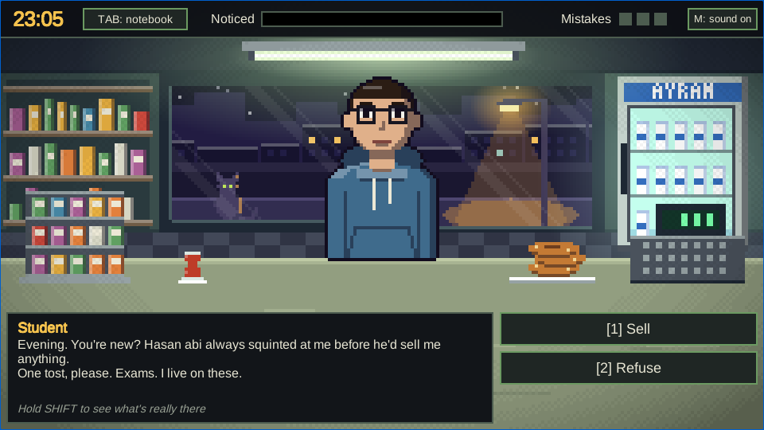

# Night Shift at the Büfe

You work the night shift, 23:00 to 06:00, at a neighbourhood büfe in İzmir. People come in for tost, ayran, simit and cigarettes. Some of them are not people. The previous worker left a notebook of rules; follow them, decide who gets served, and make it to morning. Hold **Shift** to see the other side of the shop and what your customers really are, but the other side can see you too. One screen, 13 customers, about 10 to 15 minutes.

**Made for Game Off 2026 — theme: SHIFT.**

## How the theme is used

- **The Shift key.** Holding Shift shows the other side of the shop: missing shadows, a whistle that is no longer there, eyes that look back. Some rules in the notebook can only be checked this way.
- **The night shift.** The whole game is one work shift behind the counter.
- **What the shift does to you.** Looking has a cost. Look too long at once and you are noticed; look too much over the night and you do not go home the same.

## Screenshot



## Play

<!-- TODO: add the itch.io link once the page is published -->
Play in the browser on itch.io: **TODO**

## Controls

| Input | Action |
|---|---|
| Hold **Shift** | See the other side of the shop (fills the Noticed meter) |
| **1** / **2** / **3**, or click the buttons | Sell / Refuse / Special action (only some customers have a third option) |
| **Tab** | Open or close the notebook of rules |
| **Enter** or **Space** | Start / Continue |
| **M** | Mute |

There are four endings.

## How it is built

- **No external assets.** Every sprite and every sound is generated from code at runtime (`SpriteFactory`, `AudioController`). The repository contains no image or audio files.
- **Data-driven.** Customers, rules, balance numbers and all text live in `Assets/Game/Resources/Data/*.json`.
- **One scene, one object.** `Assets/Game/Scenes/Main.unity` contains a single `GameBootstrap` object, which creates the camera and every system when the game starts.

```
Assets/Game/
  Editor/           ProjectBuilder: creates the scene, sets player settings, builds WebGL
  Resources/Data/   customers.json, rules.json, strings.json, balance.json
  Scenes/           Main.unity (generated by ProjectBuilder)
  Scripts/
    Core/           GameBootstrap, data models, events, interfaces
    Gameplay/       GameSession: the rules of the night as plain C#
    UI/             Screens, HUD, notebook
    Art/            Procedural sprites and the shop view
    Audio/          Procedural sound
  Tests/            EditMode tests
Docs/               Design and architecture documents
```

More detail: [Docs/GDD.md](Docs/GDD.md) (game design) and [Docs/ARCHITECTURE.md](Docs/ARCHITECTURE.md) (code structure).

## Building

### Requirements

- Unity **6000.6.9f1** with the **WebGL Build Support** module (install both from Unity Hub).
- Python 3, only for testing the build locally.

### From the Editor

Open the project and use the **Night Shift** menu: **Create Scene**, **Configure Player Settings**, **Build WebGL**. The build is written to `Builds/WebGL`.

### From the command line (batch mode)

**Close the Unity Editor first.** Only one Unity process can have the project open, and batch mode fails if the Editor is running.

The commands below are for macOS and are run from the project folder. On other systems, change the path to the Unity executable.

```sh
UNITY="/Applications/Unity/Hub/Editor/6000.6.9f1/Unity.app/Contents/MacOS/Unity"

# 1. Create Assets/Game/Scenes/Main.unity and put it in the build settings
"$UNITY" -batchmode -nographics -projectPath "$PWD" -executeMethod NightShift.EditorTools.ProjectBuilder.CreateScene -logFile Logs/create-scene.log -quit

# 2. Apply the player settings (name, 960 x 540 canvas, no compression, ...)
"$UNITY" -batchmode -nographics -projectPath "$PWD" -executeMethod NightShift.EditorTools.ProjectBuilder.ConfigurePlayerSettings -logFile Logs/configure.log -quit

# 3. Build WebGL into Builds/WebGL (also does steps 1 and 2 if needed)
"$UNITY" -batchmode -nographics -projectPath "$PWD" -executeMethod NightShift.EditorTools.ProjectBuilder.BuildWebGL -logFile Logs/build-webgl.log -quit
```

Each command exits with a non-zero code on failure. Search the log for `[ProjectBuilder]` to see the result, for example `[ProjectBuilder] BUILD SUCCEEDED: <size> bytes, <seconds>s`.

### Running the tests

EditMode tests run in batch mode too. Do **not** add `-quit` here: the test runner closes Unity by itself when it has finished.

```sh
"$UNITY" -batchmode -nographics -projectPath "$PWD" -runTests -testPlatform EditMode -testResults "$PWD/Logs/editmode-results.xml" -logFile Logs/editmode.log
```

The exit code is 0 when all tests pass; the details are in the XML file.

### Testing the build locally

A WebGL build does not run from `file://`; it needs a web server.

```sh
cd Builds/WebGL && python3 -m http.server 8000
```

Then open <http://localhost:8000>.

## Uploading to itch.io

1. Zip the **contents** of `Builds/WebGL`, so that `index.html` is at the root of the zip (not inside a folder):

   ```sh
   cd Builds/WebGL && zip -r ../night-shift-webgl.zip .
   ```

   This creates `Builds/night-shift-webgl.zip`.
2. On itch.io, choose **Upload new project**.
3. Set **Kind of project** to **HTML**.
4. Under **Uploads**, upload `night-shift-webgl.zip` and tick **This file will be played in the browser**.
5. Under **Embed options**, set the viewport dimensions to **960 x 540** and enable the **Fullscreen button**.
6. Link the source code from the game page: `https://github.com/ecekabasakal/night-shift-at-the-bufe`. Game Off requires the source to be in a public GitHub repository.
7. Save the page, check that the game runs in the browser, and set the page to public.
8. Open the Game Off 2026 jam page, press **Submit your project** and select the game.

The build is made without compression (`ProjectBuilder.ConfigurePlayerSettings` sets this), because itch.io does not serve the headers that Unity's compressed builds need.

## Credits

<!-- TODO: author credits -->
Design, code, art and sound: TODO

Built with Unity 6. No third-party assets.

## Licence

<!-- TODO: choose a licence -->
TODO: the licence has not been chosen yet.
